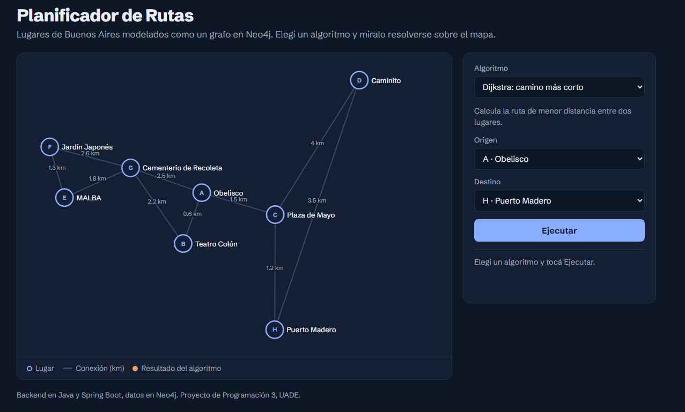
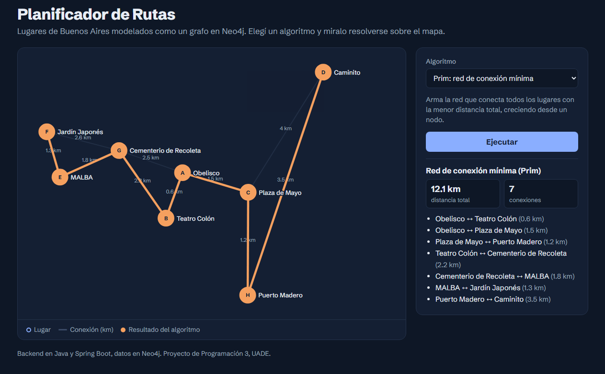

# Planificador de Rutas con Algoritmos de Grafos

Aplicación que modela lugares turísticos de Buenos Aires como un grafo y calcula rutas, redes óptimas e itinerarios con 11 algoritmos clásicos. Tiene un backend en **Java y Spring Boot**, guarda el grafo en **Neo4j** y muestra los resultados en una **interfaz web interactiva** que dibuja cada algoritmo sobre el mapa.

> 🔗 **Demo online:** [https://planificador-rutas-036d.onrender.com/] (https://planificador-rutas-036d.onrender.com/)

> La demo está en un servidor gratuito: si nadie la usó en un tiempo, la primera carga puede tardar alrededor de un minuto
>
> Proyecto desarrollado para la materia Programación 3 (UADE, 2025).



## Qué se puede hacer

- Encontrar el **camino más corto** entre dos lugares.
- Ver qué lugares son **alcanzables** desde un origen, por distancia o por cantidad de conexiones.
- Recorrer el grafo **en profundidad** y ver el orden de visita.
- Calcular la **red de conexión mínima** que une todos los lugares.
- Armar **itinerarios optimizados** según el tiempo y el presupuesto disponibles.
- **Ordenar** lugares por popularidad, precio u otros criterios.



## Tecnologías

| Capa | Tecnología |
|---|---|
| Backend | Java 17, Spring Boot 3.5, Spring Web |
| Base de datos | Neo4j (base de grafos) con Spring Data Neo4j |
| Frontend | HTML, CSS y JavaScript, servido por Spring Boot |
| Build | Maven |

## Algoritmos implementados

| Algoritmo | Uso en el proyecto |
|---|---|
| Dijkstra | Ruta de menor distancia entre dos lugares |
| BFS (búsqueda en anchura) | Lugares alcanzables desde un origen, por radio o por cantidad de saltos |
| DFS (búsqueda en profundidad) | Recorrido exploratorio del grafo |
| Prim | Red de conexión mínima, creciendo desde un nodo |
| Kruskal + Union-Find | Red de conexión mínima, ordenando conexiones y evitando ciclos |
| Greedy | Ruta rápida que visita primero el lugar deseado más cercano |
| Programación Dinámica | Itinerario que maximiza la popularidad dentro del tiempo disponible |
| Backtracking | Todas las combinaciones válidas de itinerarios |
| Branch and Bound | Itinerario óptimo respetando tiempo y presupuesto |
| QuickSort / MergeSort | Ordenamiento de lugares según distintos criterios |

## Cómo funciona

```
Navegador (interfaz web)  →  API REST (Spring Boot)  →  Neo4j (grafo)
                                     │
                          Algoritmos en Java (paquete algorithm)
```

Cada **lugar** es un nodo del grafo, con nombre, tipo, popularidad, precio de entrada y tiempo recomendado de visita. Cada **conexión** es una relación entre dos lugares, con su distancia en km, tiempo y costo. La API lee el grafo desde Neo4j, ejecuta el algoritmo pedido y devuelve el resultado en JSON. La interfaz lo dibuja sobre el mapa.

## Cómo ejecutarlo

### Requisitos

- Java 17 o superior
- Una base Neo4j: puede ser gratuita en la nube con [Neo4j AuraDB Free](https://neo4j.com/cloud/aura-free) o local con Neo4j Desktop o Docker

### Pasos

1. Cloná el repositorio y entrá a la carpeta del proyecto:
   ```bash
   git clone https://github.com/Matias-G-Gomez/progra3-tpo-rutas.git
   cd progra3-tpo-rutas/demo/demo
   ```

2. Cargá los datos de ejemplo: abrí Neo4j Browser (o la sección Query de Aura), pegá el contenido de [`datos-ejemplo.cypher`](demo/demo/datos-ejemplo.cypher) y ejecutalo. Se cargan 8 lugares de Buenos Aires con sus conexiones.

3. Configurá la conexión: copiá `src/main/resources/application.properties.example` como `application.properties` y completá tus datos de Neo4j.
   ```properties
   spring.neo4j.uri=neo4j+s://TU_INSTANCIA.databases.neo4j.io
   spring.neo4j.authentication.username=neo4j
   spring.neo4j.authentication.password=TU_PASSWORD
   ```
   Para una base local, la URI es `bolt://localhost:7687`.

4. Ejecutá la aplicación:
   ```bash
   ./mvnw spring-boot:run        # Linux / Mac
   .\mvnw.cmd spring-boot:run    # Windows
   ```

5. Abrí **http://localhost:8080** para usar la interfaz web.

## API REST

### Lugares (`/api/lugares`)

| Método | Endpoint | Descripción |
|---|---|---|
| GET | `/api/lugares` | Lista todos los lugares con sus conexiones |
| GET | `/api/lugares/alcanzables?origen={id}&radioKm={km}` | Lugares dentro de un radio (BFS) |
| GET | `/api/lugares/alcanzablesPorSaltos?origen={id}&saltos={n}` | Lugares a una cantidad máxima de saltos (BFS) |
| GET | `/api/lugares/dfs?origen={id}` | Recorrido en profundidad (DFS) |
| GET | `/api/lugares/redMinima` | Red de conexión mínima (Prim) |
| GET | `/api/lugares/redMinimaKruskal` | Red de conexión mínima (Kruskal) |
| GET | `/api/lugares/ordenar?criterio={campo}&orden={asc\|desc}` | Ordenamiento con QuickSort |
| GET | `/api/lugares/ordenarMerge?criterio={campo}&orden={asc\|desc}` | Ordenamiento con MergeSort |

### Rutas

| Método | Endpoint | Descripción |
|---|---|---|
| GET | `/ruta/minima?origenId={id}&destinoId={id}` | Camino más corto (Dijkstra) |
| POST | `/greedy` | Ruta por lugares deseados (Greedy) |
| POST | `/optimizar/dp` | Itinerario optimizado (Programación Dinámica) |
| POST | `/backtracking` | Combinaciones de itinerarios (Backtracking) |
| POST | `/branchbound` | Itinerario óptimo con tiempo y presupuesto (Branch and Bound) |

Ejemplo de request para Branch and Bound:

```json
{
  "lugaresDeseados": ["A", "B", "E", "G"],
  "tiempoDisponibleMin": 300,
  "presupuestoMax": 40
}
```

## Estructura del proyecto

```
demo/demo/
├── datos-ejemplo.cypher        Datos de prueba para Neo4j
└── src/main/
    ├── java/com/prog3/demo/
    │   ├── algorithm/          Implementación de cada algoritmo
    │   ├── controller/         Endpoints de la API REST
    │   ├── dto/                Objetos de respuesta
    │   ├── model/              Lugar, Conexión, Ruta y Usuario
    │   ├── repo/               Acceso a Neo4j
    │   └── service/            Lógica que arma el grafo y llama a los algoritmos
    └── resources/
        ├── static/index.html   Interfaz web
        └── application.properties.example
```

## Autor

**Matías Germán Gómez**
[LinkedIn](https://www.linkedin.com/in/matias-german-gomez/) · [GitHub](https://github.com/Matias-G-Gomez) · [Portfolio](https://matias-gomez-black.vercel.app)
